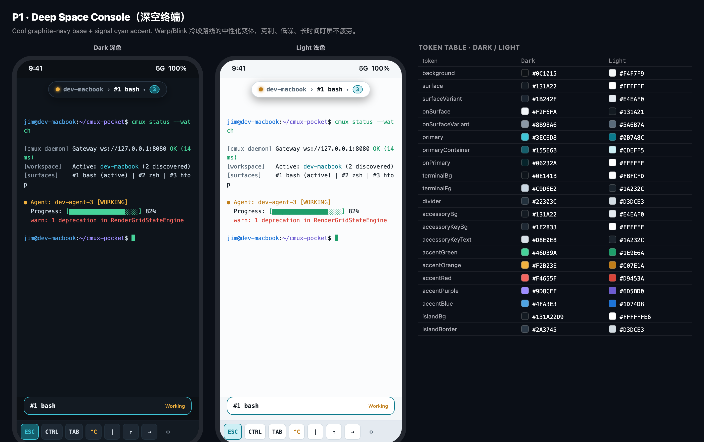
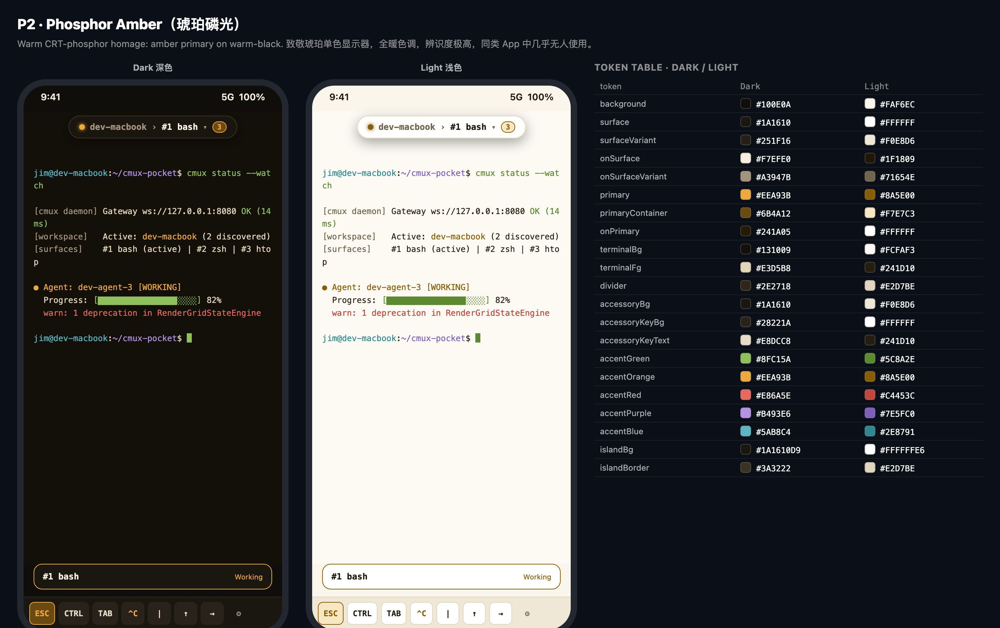
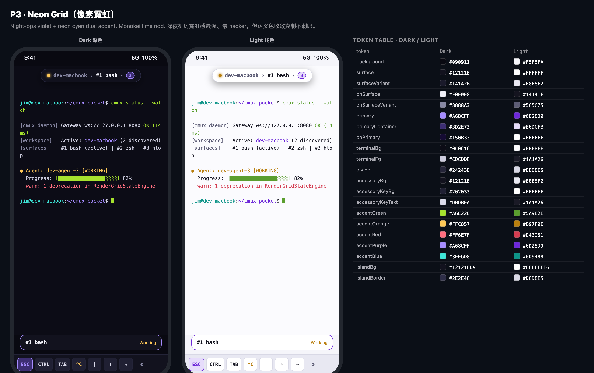

# cmux Pocket Design System — Color

Unified color system for the cmux Pocket Android app. This file is the **canonical design reference** for every color used in the app; the single source of truth in code is `CmuxColors` in `android/app/src/main/java/app/cmuxpocket/ui/CmuxTheme.kt`.

> **Status: CANDIDATE SELECTION PENDING.** Three candidate palettes (P1 / P2 / P3) are proposed below. Once the owner picks one, this section will be updated to mark the chosen palette as canonical and the other two as rejected alternatives.

## Design principles

1. **Dark-first, terminal-native.** The app is a terminal companion: dark mode is the primary experience, optimized for long sessions and OLED screens (near-black, never pure `#000000` except the canvas well).
2. **Light mode is first-class.** Every token has a designed light counterpart — not an inverted afterthought. Semantic accent hues stay constant across modes; their lightness is re-tuned per mode to preserve contrast.
3. **Single token source.** No hardcoded `Color(0x…)` outside `CmuxTheme.kt`. Components consume semantic tokens only (`surface`, `onSurfaceVariant`, `accentOrange`, …), never raw hex.
4. **Contrast floor.** Body text ≥ 4.5:1 (WCAG AA), large text/icons ≥ 3:1 against their background, in both modes.
5. **Color means state.** Semantic accents are reserved for state/severity: `green = connected/success`, `orange = working/warning`, `red = error/disconnected`, `purple = agent/AI`, `blue/cyan = info/link`. Never use them decoratively.

## Token architecture

| Token | Used by |
| --- | --- |
| `background` / `onBackground` | Root scaffold, empty states |
| `surface` / `onSurface` | Cards, drawer container, dialogs, sheets |
| `surfaceVariant` / `onSurfaceVariant` | Inset rows, secondary text, chevrons, captions |
| `primary` / `primaryContainer` / `onPrimary` | Active selection, ESC key, links, badges, focused states |
| `terminalBg` / `terminalFg` | Terminal canvas well (string hex, passed to the render engine) |
| `divider` | Hairlines, separators, key borders |
| `accessoryBg` / `accessoryKeyBg` / `accessoryKeyText` | Bottom accessory keyboard bar |
| `accentGreen` / `accentOrange` / `accentRed` / `accentPurple` / `accentBlue` | Status dot, agent states, log severities, terminal ANSI-mapped accents |
| `islandBg` / `islandBorder` | Floating island pill (frosted; includes alpha) |
| `scrim` | Modal overlay dimming |

## Candidate palettes

### P1 · Deep Space Console（深空终端）

Cool graphite-navy base with a signal-cyan primary. A neutralized evolution of the Warp / Blink Shell cool-dark school — restrained, low-noise, easy on the eyes during long sessions. The safest option; the least distinctive.

| Token | Dark | Light |
| --- | --- | --- |
| `background` | `#0C1015` | `#F4F7F9` |
| `surface` | `#131A22` | `#FFFFFF` |
| `surfaceVariant` | `#1B242F` | `#E4EAF0` |
| `onSurface` | `#F2F6FA` | `#131A21` |
| `onSurfaceVariant` | `#8B98A6` | `#5A6B7A` |
| `primary` | `#3EC6D8` | `#0B7A8C` |
| `primaryContainer` | `#155E6B` | `#CDEFF5` |
| `onPrimary` | `#06232A` | `#FFFFFF` |
| `terminalBg` | `#0E141B` | `#FBFCFD` |
| `terminalFg` | `#C9D6E2` | `#1A232C` |
| `divider` | `#22303C` | `#D3DCE3` |
| `accessoryBg` | `#131A22` | `#E4EAF0` |
| `accessoryKeyBg` | `#1E2833` | `#FFFFFF` |
| `accessoryKeyText` | `#D8E0E8` | `#1A232C` |
| `accentGreen` | `#46D39A` | `#1E9E6A` |
| `accentOrange` | `#F2B23E` | `#C07E1A` |
| `accentRed` | `#F4655F` | `#D9453A` |
| `accentPurple` | `#9D8CFF` | `#6D5BD0` |
| `accentBlue` | `#4FA3E3` | `#1D74D8` |
| `islandBg` | `#131A22D9` | `#FFFFFFE6` |
| `islandBorder` | `#2A3745` | `#D3DCE3` |

### P2 · Phosphor Amber（琥珀磷光）

A warm homage to CRT amber monochrome terminals: amber primary over warm-black. Fully warm-toned, instantly recognizable, and almost unused among contemporary terminal apps — the strongest identity of the three. Light mode becomes warm paper.

| Token | Dark | Light |
| --- | --- | --- |
| `background` | `#100E0A` | `#FAF6EC` |
| `surface` | `#1A1610` | `#FFFFFF` |
| `surfaceVariant` | `#251F16` | `#F0E8D6` |
| `onSurface` | `#F7EFE0` | `#1F1809` |
| `onSurfaceVariant` | `#A3947B` | `#71654E` |
| `primary` | `#EEA93B` | `#8A5E00` |
| `primaryContainer` | `#6B4A12` | `#F7E7C3` |
| `onPrimary` | `#241A05` | `#FFFFFF` |
| `terminalBg` | `#131009` | `#FCFAF3` |
| `terminalFg` | `#E3D5B8` | `#241D10` |
| `divider` | `#2E2718` | `#E2D7BE` |
| `accessoryBg` | `#1A1610` | `#F0E8D6` |
| `accessoryKeyBg` | `#28221A` | `#FFFFFF` |
| `accessoryKeyText` | `#E8DCC8` | `#241D10` |
| `accentGreen` | `#8FC15A` | `#5C8A2E` |
| `accentOrange` | `#EEA93B` | `#8A5E00` |
| `accentRed` | `#E86A5E` | `#C4453C` |
| `accentPurple` | `#B493E6` | `#7E5FC0` |
| `accentBlue` | `#5AB8C4` | `#2E8791` |
| `islandBg` | `#1A1610D9` | `#FFFFFFE6` |
| `islandBorder` | `#3A3222` | `#E2D7BE` |

### P3 · Neon Grid（像素霓虹）

Night-ops neon: violet primary with a neon-cyan secondary accent and a Monokai-lime nod for success. The most overtly "hacker" of the three, with semantic accents deliberately desaturated enough to avoid eye-searing. Light mode subdues the neon into violet/teal ink.

| Token | Dark | Light |
| --- | --- | --- |
| `background` | `#090911` | `#F5F5FA` |
| `surface` | `#12121E` | `#FFFFFF` |
| `surfaceVariant` | `#1A1A2B` | `#E8E8F2` |
| `onSurface` | `#F0F0F8` | `#14141F` |
| `onSurfaceVariant` | `#8888A3` | `#5C5C75` |
| `primary` | `#A68CFF` | `#6D28D9` |
| `primaryContainer` | `#3D2E73` | `#E6DCFB` |
| `onPrimary` | `#150B33` | `#FFFFFF` |
| `terminalBg` | `#0C0C16` | `#FBFBFE` |
| `terminalFg` | `#CDCDDE` | `#1A1A26` |
| `divider` | `#242438` | `#D8D8E5` |
| `accessoryBg` | `#12121E` | `#E8E8F2` |
| `accessoryKeyBg` | `#202033` | `#FFFFFF` |
| `accessoryKeyText` | `#DBDBEA` | `#1A1A26` |
| `accentGreen` | `#A6E22E` | `#5A9E2E` |
| `accentOrange` | `#FFC857` | `#B97F0E` |
| `accentRed` | `#FF6E7F` | `#D43D51` |
| `accentPurple` | `#A68CFF` | `#6D28D9` |
| `accentBlue` | `#3EE6D8` | `#0D9488` |
| `islandBg` | `#12121ED9` | `#FFFFFFE6` |
| `islandBorder` | `#2E2E48` | `#D8D8E5` |

## References and deliberate divergence

- **Tokyo Night** (verified against the official VS Code theme JSON): purple `#bb9af7`, cyan `#2ac3de`, amber `#e0af68`, foreground `#c0caf5`. P3 borrows its violet/cyan tension but darkens the base to `#090911` and pushes lime into success, avoiding a straight clone.
- **Warp** (community `warp.yaml`, verified): accent `#5299bf` — a muted steel blue. P1 deliberately shifts the primary toward cyan (`#3EC6D8`) to escape the ubiquitous "GitHub/Warp steel blue".
- **Catppuccin** (public theme family): pastel-on-mauve-dark; cited as inspiration only, no values copied — its lavender base is becoming a cliché across dev tools.
- **Blink Shell / Prompt 3** (studied via Mobbin earlier in this project): near-monochrome system-native palettes; we keep their restraint in the neutral tokens but add a real accent identity, which they lack.
- **CRT amber phosphor monitors** (P2): historical terminal hardware — amber P1 phosphor, re-tuned to modern contrast floors.

## Usage rules (binding)

1. All component colors must resolve through `CmuxTheme.colors`; new colors require a new token in this file first, then in `CmuxColors`.
2. Semantic accents are state-only (see principle 5). The island status dot, agent badges, and log severities must use them; decoration must not.
3. `islandBg` always carries alpha (frosted glass over the canvas); `islandBorder` is a hairline, never a solid outline.
4. The terminal canvas (`terminalBg`/`terminalFg`) is part of the app theme, not the remote host's ANSI palette — ANSI colors from cmux render unchanged; these two tokens only set the well and default foreground.
5. Light mode re-tunes accent lightness; hues never shift between modes.
