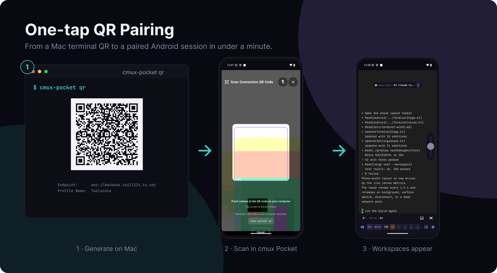

# cmux Pocket

[](https://github.com/shiquda/cmux-pocket/releases/latest)
[](https://github.com/shiquda/cmux-pocket)
[](LICENSE)

cmux Pocket is an independent Android companion for [cmux](https://cmux.com/) on macOS, delivering authoritative multi-workspace terminal streaming, an immersive viewport, and one-tap QR pairing over a secure Gateway.

> **Disclaimer:** Independent community project. Not affiliated with or endorsed by cmux. “cmux” identifies the compatibility target only.

[Download Signed APK](https://github.com/shiquda/cmux-pocket/releases/latest) · [Install with Obtainium](#3-install-the-android-app) · [Quick Start](#quick-start) · [Networking Guide](docs/networking.md) · [Design System](DESIGN.md) · [Changelog](CHANGELOG.md)


---

## Screenshots

<table>
  <tr>
    <td></td>
    <td></td>
    <td></td>
    <td></td>
  </tr>
</table>

Captured on a 1080 × 2400 Android emulator against a local Gateway.

---

## Highlights

- **Pure Immersive Viewport & Floating Island**: Fullscreen terminal canvas with a dynamic breadcrumb island pill (`[status] workspace > #session [count]`) for instant session context, switching, and status indication.
- **Authoritative Terminal Streaming**: Renders `cmux.render-grid.v1` differential grid frames directly over WebSocket (`wss://`). The Mac owns the PTY and VT parsing—Android runs zero local shells, ensuring 100% terminal state fidelity.
- **Decoupled Dual-End Navigation**: Switch workspaces or tabs on the phone without changing your Mac's active focus; main-screen scrollback stays local to Android while alternate-screen/TUI scrollback remains cmux-managed.
- **One-Tap Pairing via CLI QR Code**: Generate pairing QR codes in your Mac terminal (`cmux-pocket qr`) — with an interactive picker for saved, Tailscale, Cloudflare Tunnel, and USB endpoints — and scan with the in-app camera for instant, validated profile import with overwrite protection.
- **Remote Wake & Version Transparency**: If the Gateway is online but cmux.app is not running, the terminal offers **Wake cmux on Mac** and switches to the live terminal once the socket is ready. Settings → Connection shows the Gateway, app, and protocol versions with a compatibility badge and a copyable Mac upgrade command.
- **Modernized Settings Hub**: Sectioned navigation with a 500-line diagnostics log, profile backup/restore via clipboard, and an in-app GitHub Releases update checker.
- **Neon Grid Color System**: Unified violet/neon-cyan/lime color palette optimized for OLED screens, with a first-class tuned light mode and contrast WCAG AA compliance.
- **High-Performance Rendering**: Batched text runs, memoized ARGB cell parsing, and cached row pictures keep scrolling and resizing smooth.
- **Bilingual Localization**: Native English and 简体中文 support across all screens and notifications, switchable at runtime.
- **Local-First & Zero Telemetry**: Loopback-only Mac Gateway with a random bearer token and encrypted Android Keystore storage. There is no backend server and no analytics; the camera is used only for QR pairing, and notifications are optional.

---

## Architecture


cmux Pocket uses a local-first, decoupled architecture:
1. **cmux (macOS)**: Runs the real terminal instances and manages terminal state, window geometry, and process lifecycles.
2. **cmux-pocket Gateway (macOS)**: A lightweight Rust daemon listening strictly on `127.0.0.1:8088`. Queries cmux via its UNIX domain socket and streams differential render grids over WebSocket.
3. **Secure Network Boundary**: Tailscale HTTPS Serve (`.ts.net`), LAN reverse proxy (Caddy / Nginx), or SSH/VPN tunnel terminates TLS before forwarding traffic to the loopback Gateway.
4. **cmux Pocket (Android)**: A Jetpack Compose application rendering grid cells with Maple Mono Nerd Font, handling local touch gestures and accessory keyboard input without running a local terminal parser.

---

## Quick Start

### 1. Prerequisites
- **macOS**: [cmux](https://cmux.com/) installed and running (`cmux ping`).
- **Android**: Android 8.0+ (API 26+) device or emulator.
- **Networking**: Tailscale (recommended), Cloudflare Tunnel, or a user-managed TLS reverse proxy.

### 2. Install the macOS CLI & Gateway

Install the Gateway CLI via Homebrew and start the background service:

```bash
brew install shiquda/cmux-pocket/cmux-pocket
cmux-pocket setup
cmux-pocket status
```

`cmux-pocket setup` is idempotent: it provisions an authenticated bearer token with user-only permissions (`0600`), creates a macOS LaunchAgent, and tests local connectivity.

To upgrade, run `cmux-pocket upgrade`: it compares the installed build with the latest GitHub Release, hands the upgrade to whichever package manager installed the CLI (`brew upgrade shiquda/cmux-pocket/cmux-pocket`, or `cargo install --force --git … --tag <release> cmux-pocket-cli`), and restarts the LaunchAgent so the new Gateway serves the phone immediately. `cmux-pocket upgrade --check` only reports whether an update exists, and `--json` keeps it scriptable. The command never overwrites the binary itself: an install it cannot attribute to Homebrew or `cargo install` is reported with both commands to run by hand.

If `cmux-pocket --version` reports an older build than `brew list --versions cmux-pocket`, a duplicate binary earlier in `PATH` (for example an old `~/.local/bin/cmux-pocket` from a manual `cargo install`) is shadowing Homebrew: remove it, then rerun `cmux-pocket setup` so the LaunchAgent points at the Homebrew `opt` path again. `cmux-pocket upgrade` prints the same warning when the registered LaunchAgent runs a different binary than the one it just upgraded.

### 3. Install the Android App

Install cmux Pocket using either Obtainium for source updates or by downloading the signed APK directly:

#### Option A: Automatic Updates via Obtainium (Recommended)
[Obtainium](https://github.com/ImranR98/Obtainium) checks GitHub Releases for updates and lets you install them on Android:
1. In Obtainium, tap **Add App** and paste the repository URL:
   ```text
   https://github.com/shiquda/cmux-pocket
   ```
   *(Or tap the [Obtainium Deep Link](obtainium://add/https://github.com/shiquda/cmux-pocket) directly on your Android device).*
2. Leave the asset filter settings at default. Obtainium detects release APKs automatically (`app-release.apk` on existing releases and `cmux-pocket-vX.Y.Z.apk` on upcoming releases). **Do not** add a custom filename filter that matches only one pattern.
3. Tap **Add** to fetch and install the release.

#### Option B: Direct Signed APK Download
Download the latest signed release APK directly from [GitHub Releases](https://github.com/shiquda/cmux-pocket/releases/latest) and install it on Android.

Verification details:
- **Application ID:** `app.cmuxpocket`
- **Signing Certificate SHA-256:** `c801d49f10948b465936c3155fa5ffef4fea7b2a1b0f029804bf4a7ea68282fa`

### 4. Pair with Android in One Tap

Generate a pairing QR code in your Mac terminal:

```bash
cmux-pocket qr
```

In a terminal this opens an interactive picker with the first endpoint's QR already rendered:
switch between saved endpoints, a verified Tailscale Serve route, Cloudflare Tunnel hostnames,
and USB with ↑/↓ and the QR re-renders live; press Enter to confirm that endpoint. `--endpoint`
skips the picker, and `--no-interactive`, `--json`, and `--url-only` keep single-shot behavior.

Save additional endpoints once:

```bash
cmux-pocket endpoint add wss://gateway.lan.example --name LAN
cmux-pocket endpoint list
```

Pairing steps on your phone:
1. Open **Settings → Connection** and tap **Scan QR**.
2. Point your camera at the Mac terminal. Review the **Import Preview** dialog and tap **Import & Connect**.

Your cmux workspaces and tabs appear immediately on Android.



---

## Interface & Interactions


### Terminal Navigation & Sessions
- **Floating Island Pill**: Shows current workspace, active session number, and connection status. Tapping the pill opens the **Sessions & Surfaces Drawer** to switch workspaces or create new tabs on the fly.
- **Landscape Sidebar**: On wider screens and landscape orientation, a collapsible sidebar displays workspaces and tabs alongside the terminal.

### Touch Gestures & Viewport
- **Pinch to Zoom**: Adjust text size smoothly via pinch gesture, or use **A− / A+** controls.
- **Pan & Scroll**: Drag with one or two fingers to scroll through scrollback or navigate wide columns.
- **Double Tap**: Instantly fits the terminal width to your screen.
- **Phone-width layout**: The bottom bar's **Width** control shows the computer's grid and the grid the phone would request, then asks cmux to resize the shared PTY so host-side TUIs reflow for the phone. A restore button returns to the Mac layout; backgrounding or leaving a surface releases this device's report. The mode is shared, the host clamps it, and another connected client always wins the minimum — see [docs/terminal-width.md](docs/terminal-width.md).
- **Contextual Action Bubble**: Long-press any terminal text to select and access one-tap actions: Copy selection, Copy screen, Paste at cursor, Send interrupt (Ctrl+C), or Clear screen.

### Accessory Keyboard Bar
A compact, scrollable accessory row above the keyboard provides the developer keys missing from mobile software keyboards: `ESC`, `Enter`, `TAB`, `^C`, navigation arrows (`↑`, `↓`, `←`, `→`), symbol shortcuts (`|`, `/`, `-`, `~`), plus shortcuts for the floating window and settings. The full Computer Keyboard panel (F1–F12, function combinations) is one tap away.

---

## Settings & Diagnostics


- **Connection Profiles**: Manage multiple hosts (Tailscale, LAN, Cloudflare Tunnel, USB Reverse) with encrypted credential storage in Android Keystore.
- **Gateway Versions & Upgrades**: The Connection page reports Gateway, app, and cmux protocol versions, flags protocol mismatches or a Gateway that lacks remote wake, and offers a one-tap copy of the Mac upgrade command plus a direct latest-APK link.
- **Live Diagnostics**: Built-in 500-line log captures WebSocket handshakes, connection state changes, and RPC traffic. Export redacted JSON logs directly to clipboard for troubleshooting.
- **Data & Backup**: Export and import host profiles via clipboard JSON. Export asks whether to include the Gateway access keys: without them the JSON carries endpoints only, and you can fill a key in after importing.
- **In-App Updates**: Check for new releases directly against GitHub Releases and download updated APKs in one tap.

---

## Networking Options


| Method | Endpoint | Security | Recommended For |
| :--- | :--- | :--- | :--- |
| **Tailscale** *(Recommended)* | `wss://<node>.ts.net:443` | TLS via Tailscale HTTPS | Remote and LAN use with zero port forwarding |
| **LAN Reverse Proxy** | `wss://gateway.local` | TLS (Caddy / Nginx / Certbot) | High-speed local network setups |
| **USB Reverse (Dev)** | `ws://127.0.0.1:8088` | Cleartext loopback only | Local testing with `adb reverse tcp:8088 tcp:8088` |

> 🔒 **Security Notice:** The Gateway strictly refuses non-loopback binds. The Android client requires `wss://` for any non-loopback address. Cleartext `ws://` is strictly limited to loopback/USB testing.

For detailed Caddy, Nginx, Tailscale Serve, and LaunchAgent configurations, see [docs/networking.md](docs/networking.md).

---

## Development & Building

### Requirements
- **Rust**: 1.75+ (stable)
- **Android**: JDK 17, Android SDK 35
- **Python**: 3.11+ (legacy gateway reference test suite only)

### Rust Gateway & CLI
```bash
# Run unit and integration tests
cargo test --workspace --locked

# Run CLI doctor diagnostics
cargo run -p cmux-pocket-cli -- doctor --offline --json

# Build release CLI binary
cargo build --release -p cmux-pocket-cli
```

### Android App
```bash
cd android

# Run unit tests
./gradlew testDebugUnitTest

# Assemble debug APK
./gradlew assembleDebug

# Stop Gradle daemon after build (resource hygiene)
./gradlew --stop
```

### Releases & Changelog
Release bodies are generated directly from [CHANGELOG.md](CHANGELOG.md). Before tagging a `v*` release, add a `## [X.Y.Z] - YYYY-MM-DD` section. The release workflow extracts this section using `scripts/release-notes-from-changelog.sh` to populate GitHub Releases notes automatically. Bump the workspace version in `Cargo.toml` and the Android `versionName` to the tag's number first: the APK workflow rejects a mismatched `versionName`, and the Homebrew tap rejects a tag whose `Cargo.toml` version differs.

The Gateway's formula lives only in `shiquda/homebrew-cmux-pocket`. Its scheduled workflow resolves the latest GitHub Release, verifies that tag's `Cargo.toml`, and rewrites `Formula/cmux-pocket.rb` to install that tag at its exact commit, so `brew upgrade` reaches a new Gateway without editing the tap by hand. This repository intentionally keeps no copy of the formula.

---

## Security & Vulnerability Reporting

- **Loopback Enforcement**: The Gateway strictly binds to `127.0.0.1`.
- **Encrypted Storage**: Connection profiles and auth tokens are stored using `EncryptedSharedPreferences` backed by the Android Keystore. Android app backup (`allowBackup`) is disabled.
- **Data Protection**: Zero telemetry, zero analytics, zero external cloud servers.
- **Reporting**: Report security vulnerabilities privately via GitHub's [Security Advisory](https://github.com/shiquda/cmux-pocket/security/advisories/new). Never post tokens, tunnel URLs, or credentials in public issues.

---

## License

- **Code**: Licensed under the [GNU Affero General Public License v3.0](LICENSE) (AGPL-3.0).
- **Fonts**: Bundled [Maple Mono NF](LICENSES/MapleMono-OFL-1.1.txt) is licensed under the [SIL Open Font License 1.1](http://scripts.sil.org/OFL).
- See [THIRD_PARTY_NOTICES](THIRD_PARTY_NOTICES) for third-party dependencies.
