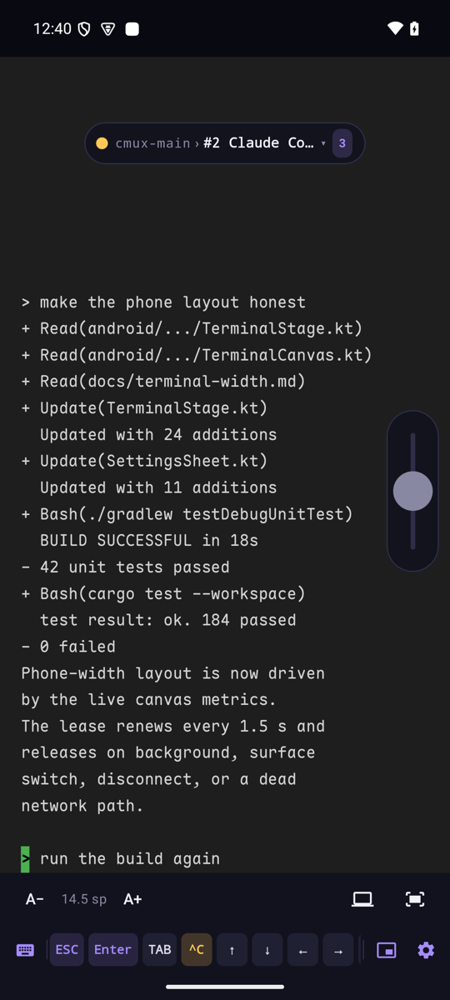
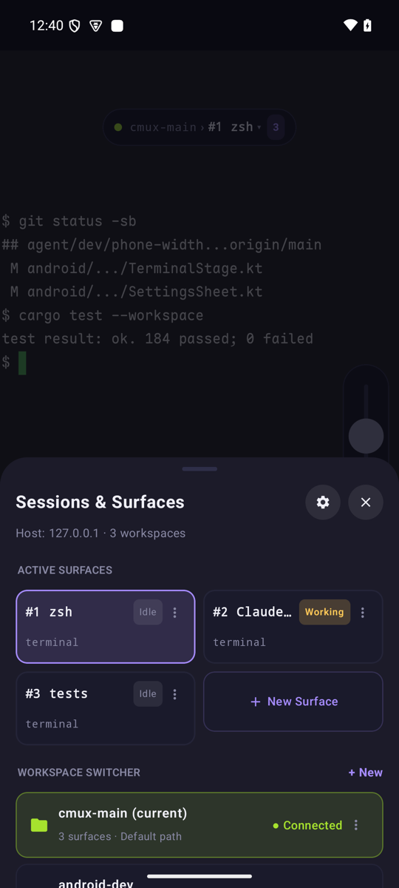
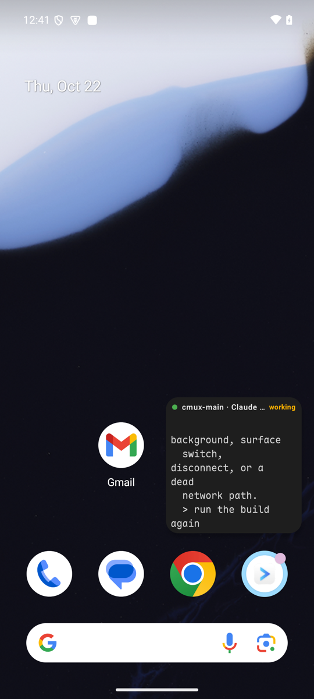
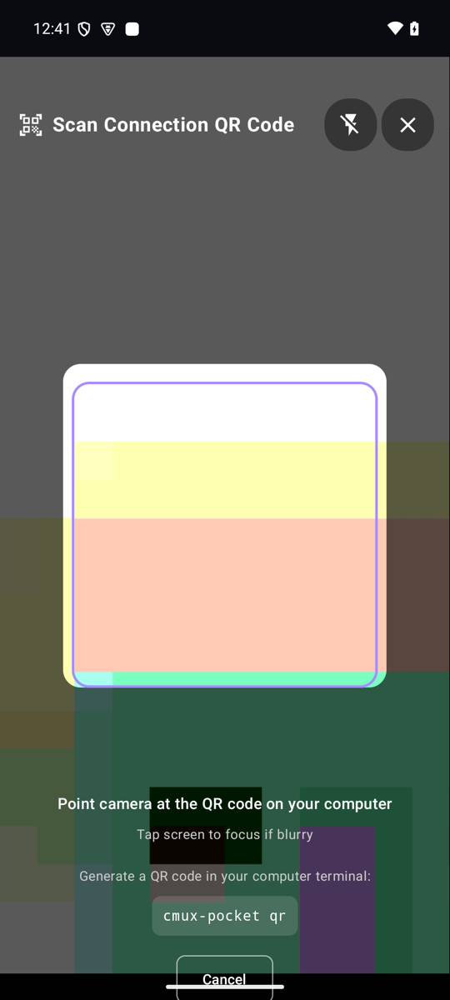
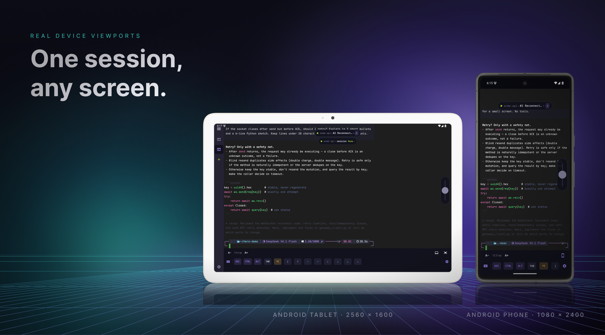
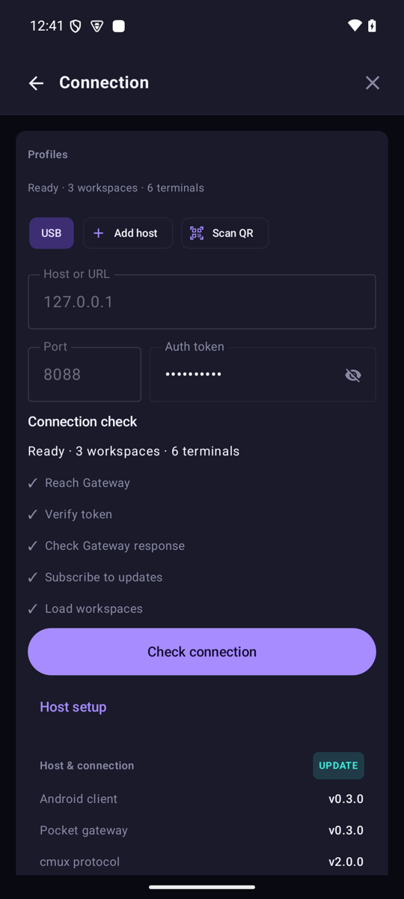

# App guide

[Quick start](../README.md#quick-start) · [Networking & troubleshooting](networking.md)

## Sessions and navigation

Switch workspaces or tabs on the phone without changing the Mac's focus. The floating island shows the current workspace, session number, and connection status; tap it to open the sessions drawer. Wider screens add a collapsible workspace sidebar.

<table>
  <tr>
    <td></td>
    <td></td>
    <td></td>
    <td></td>
  </tr>
</table>

## Touch and keyboard

- **Pinch** or **A− / A+** to change text size.
- **Drag** with one or two fingers to scroll history or navigate wide columns. Main-screen scrollback stays on Android; alternate-screen/TUI scrollback stays cmux-managed.
- **Double tap** to fit the terminal to the screen width.
- **Width** in the bottom bar requests a shared PTY resize so host-side TUIs reflow for the phone; **Restore** returns to the Mac layout. Leaving a surface or backgrounding releases this device's report, and other clients can constrain the size. See [terminal width](terminal-width.md).
- **Long press** terminal text to select it, then Copy selection, Copy screen, Paste at cursor, Send interrupt (Ctrl+C), or Clear screen.

The accessory row provides `ESC`, `Enter`, `TAB`, `^C`, arrows, symbols, and shortcuts for the floating window and settings; the Computer Keyboard panel adds F1–F12 and function combinations.

## Settings and diagnostics

- **Connection profiles:** Android Keystore-backed encrypted credential storage.
- **Versions:** the Connection page shows Gateway, app, and protocol versions, compatibility warnings, the Mac upgrade command, and the latest APK link.
- **Remote wake:** when the Gateway is online but cmux is closed, **Wake cmux on Mac** starts the app. It cannot wake a sleeping or offline Mac; see [remote wake](networking.md#remote-wake-and-gateway-version-checks).
- **Diagnostics:** inspect the built-in 500-line connection/RPC log, or export redacted JSON to the clipboard.
- **Backup:** export/import host profiles as clipboard JSON, choosing whether to include access keys; treat any export containing keys as a secret.
- **Updates:** check GitHub Releases from the app and download the latest APK.
- **Language:** switch between English and 简体中文 at runtime.

## APK verification

Download the signed APK from [GitHub Releases](https://github.com/shiquda/cmux-pocket/releases/latest).

- **Application ID:** `app.cmuxpocket`
- **Signing certificate SHA-256:** `c801d49f10948b465936c3155fa5ffef4fea7b2a1b0f029804bf4a7ea68282fa`

Connection setup, scanner behavior, and import confirmation: [QR pairing](networking.md#3-qr-code-pairing-and-one-tap-import-cmux-pocket).
