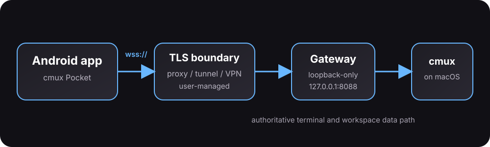
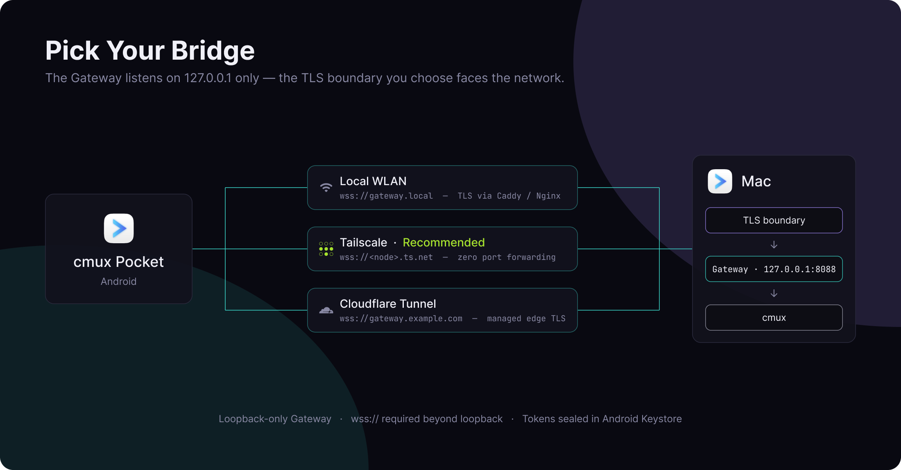

# Architecture

[Quick start](../README.md#quick-start) · [Networking](networking.md) · [Design system](../DESIGN.md)

1. **cmux (macOS)** owns the real PTY, VT parsing, terminal state, and process lifecycles.
2. **cmux-pocket Gateway (macOS)** is a Rust daemon bound to `127.0.0.1:8088` by default. It queries cmux through its UNIX domain socket and streams `cmux.render-grid.v1` differential grid frames over WebSocket.
3. **TLS boundary** makes the loopback Gateway reachable through Tailscale HTTPS Serve, a LAN reverse proxy, or a secure tunnel.
4. **cmux Pocket (Android)** renders grid cells with Jetpack Compose and Maple Mono Nerd Font. It handles touch and accessory keyboard input without running a local shell or terminal parser. Batched text runs, memoized ARGB cell parsing, and cached row pictures support rendering.

## Network and data boundaries

The Gateway refuses non-loopback binds. Android requires `wss://` for non-loopback endpoints; cleartext `ws://` is limited to loopback/USB testing. See [connection rules](networking.md#connection-rules) before configuring a proxy or tunnel.

The Gateway authenticates clients with a random bearer token. Android stores connection profiles and tokens in encrypted preferences backed by Android Keystore; app backup is disabled. There is no project-operated backend or analytics service. The camera is used for QR pairing, and agent-completion notifications are optional.

QR codes and profile exports containing access keys are credentials. Do not include them in public screenshots, logs, or issues. Report vulnerabilities privately through [GitHub Security Advisories](https://github.com/shiquda/cmux-pocket/security/advisories/new).
